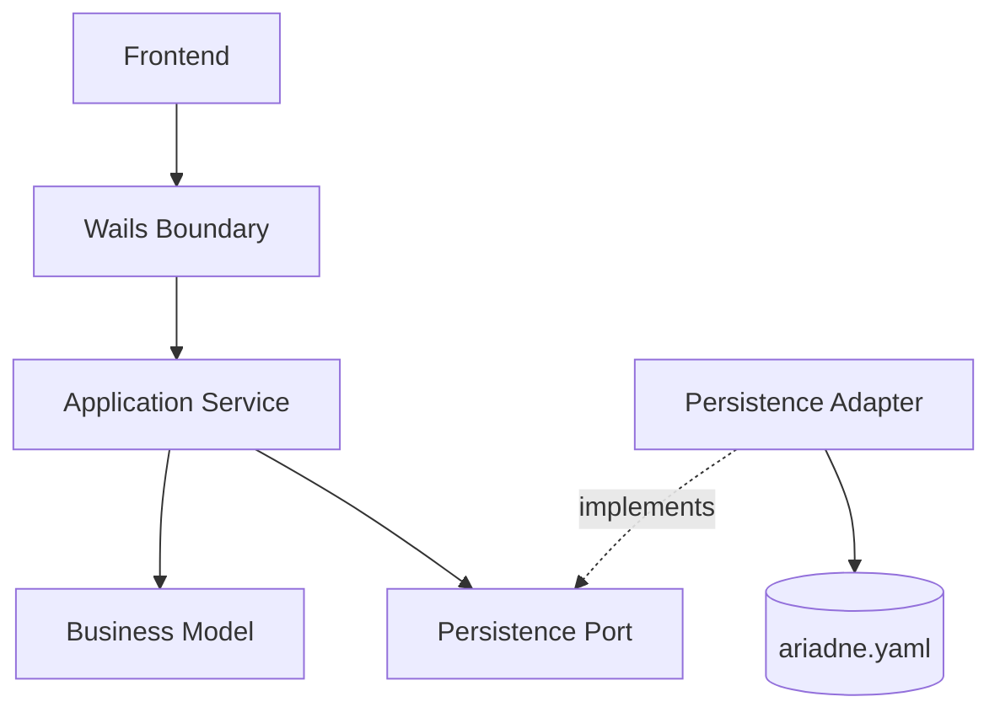

# Overall Architecture

## Architecture Principles

PROJECT ARIADNEは、**Business Modelを中心としたアーキテクチャ**を基本とする。

業務概念・ルール・整合性をBusiness Modelに表現し、それを基準としてアプリケーション全体を設計する。DDDの考え方と親和性はあるが、特定の設計手法への準拠を目的とはしない。

以下を基本原則とする。

1. **Business Model中心**：業務概念・ルール・整合性はBusiness Modelが保証し、Serviceはユースケースを組み立てる。
2. **責務に基づく分離**：Frontend・Wails Boundary・Service・Business Model・Persistence Adapterの責務を明確にする。コードの類似性だけを理由に共通化しない。
3. **正本の明確化**：業務定義は単一の`ariadne.yaml`を正本とする。Business Model・Public Model・Frontend Storeは、それぞれ異なる目的を持つ。
4. **各層の成立条件**：Frontendは画面・操作という断面での成立条件を扱い、BackendはBusiness Model全体の整合性を保証する。
5. **段階的な具体化**：基本原則を前提とし、具体的な処理分担・連携方式は必要なFeatureの設計時に決定する。

## Overall Structure

Coreは単一アプリケーションを基本とする。Elements・DB・APIなどの機能領域は、必要な責務に応じて分離する。

この図は主要な構成要素と関係を示す概念図であり、具体的な呼出し順序や全依存関係を確定するものではない。

## Responsibilities & Dependencies

| 構成要素 | 基本責務 |
|---|---|
| Frontend | 業務概念に基づく表示・操作、画面・操作の範囲でのValidation |
| Wails Boundary | FrontendとBackendの接合。業務判断を持たず、Serviceへ委譲 |
| Application Service | Business Modelを用いてユースケースを組み立てる |
| Business Model | 業務概念・ルール・不変条件と、モデル全体の整合性を保証する |
| Persistence Port | Serviceが依存する永続化の抽象 |
| Persistence Adapter | 永続化の具体的な実装。Persistence Modelを内部に閉じる |
| `ariadne.yaml` | 業務定義の単一の正本 |

Serviceは永続化の具体的なAdapterではなく、Persistence Portの抽象に依存する。

Business Model・Public Model・Frontend Storeは同じ情報を扱う場合でも責務が異なる。各モデルの具体的な変換・保持・更新の方法は、対応するアーキテクチャ文書で扱う。

## Architecture Documents

本書は全体方針を扱う。領域固有の設計は、以下の文書で管理する。

- [Frontend Architecture](frontend.md)
- [Backend Architecture](backend.md)
- [Application Boundary](boundary.md)
- [Data & Persistence](persistence.md)
- [Cross-cutting Concerns](cross-cutting.md)

上記リンク先は各文書の作成後に有効となる。

## Source

- [Prototype Phase 6 — Review 05: Architecture](https://github.com/teru-0529/project-ariadne-prototype/issues/50)（A01・総合評価）
